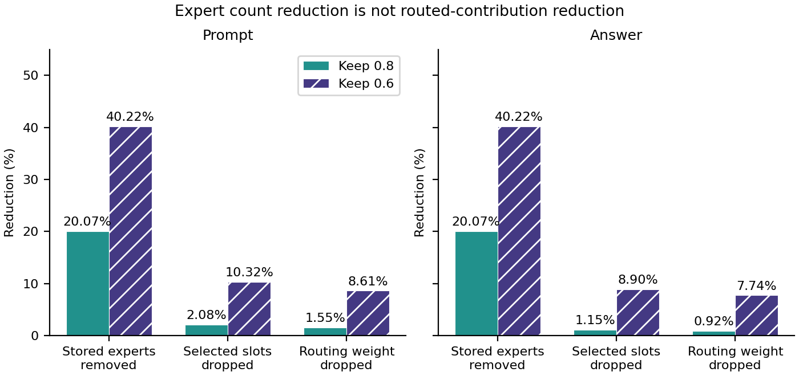
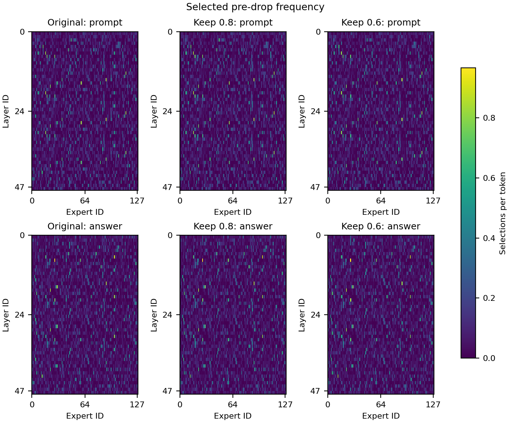
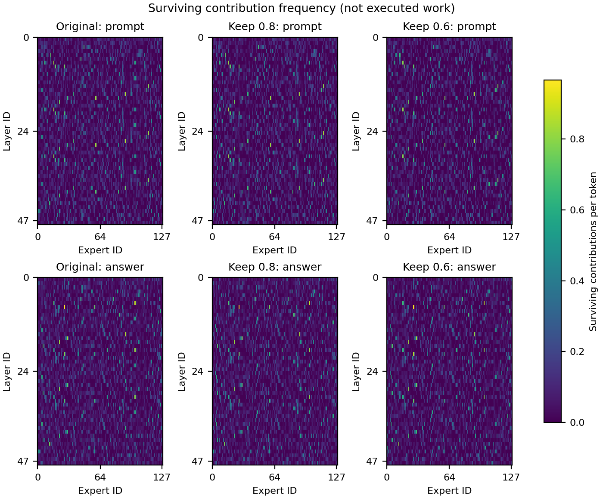

# GSM8K expert-routing comparison — completed

## Main finding

Removing 20.07% of stored experts eliminates only **1.51% of selected contributions** on this controlled GSM8K workload; removing 40.22% eliminates **9.45%**. SHAPE predominantly retains frequently selected experts. Expert-count reduction is therefore not proportional to routed-contribution reduction.

These are **measured routing statistics, not executed-GEMM counts, FLOP reductions or kernel timings**. The findings support a low-work-reduction mechanism consistent with the earlier H800 keep-0.8 throughput result, but do not causally establish why its output-token throughput changed by -0.99%.

## Protocol

- H800 PCIe GPU 3; Qwen3-30B-A3B-Instruct-2507, same original local checkpoint as the throughput experiment. Checkpoint README identifies Instruct-2507; full safetensor/config/tokenizer SHA256s are in `manifest.json`. Its upstream revision was not independently authenticated (`model_commit` and `tokenizer_commit` are null).
- All **1,319 GSM8K test questions and gold reference solutions**, in original order. Source SHA256: `3730d312f6e3440559ace48831e51066acaca737f6eabec99bccb9e4b3c39d14`.
- Original, keep-0.8 and keep-0.6 use **identical teacher-forced token IDs**. No answer generation or accuracy grading. Gold solutions are used only for analysis, never expert selection.
- **Existing GSM8K SHAPE selections reused unchanged**: 4,911/6,144 experts retained for keep-0.8; 3,673/6,144 for keep-0.6. Actual keep fractions 0.79931640625 and 0.5978190104166666.
- Transformers 5.22.1, PyTorch 2.13.0+cu130, native `grouped_mm` experts, BF16 and SDPA. No cache, no gradients, one question at a time. Three variant passes are interleaved per question; one model is loaded without mutating its weights.
- Collect native original-router top-8 IDs/weights, then mask removed contributions **without replacement or additional survivor renormalization**. A pruned pass changes downstream hidden states and can therefore change later-layer selections. This is not merely a mask drawn over original routes.
- 276,281 total sequence tokens, maximum sequence length 543, no truncation. Statistics include **101,969 literal user-content tokens** and **163,760 gold-answer tokens**; 10,552 template tokens are excluded from statistics but remain in model context. No assistant EOS is appended.
- Answer-position routing describes processing each gold token, not the preceding position predicting it. This is reference-token processing, not an autoregressive decode trace.

## Quantitative comparison

Counts and weights are pooled across all 48 layers and relevant token positions, not averaged per-question fractions. “Dropped slots” means top-8 selections assigned zero contribution after the retention mask. “Dropped weight” divides removed pre-drop routing weight by total selected pre-drop weight, allowing native BF16 rounding.

| Variant | Stored experts removed | Prompt dropped slots | Answer dropped slots | Combined dropped slots | Combined dropped weight | Combined mean survivors / 8 |
|---|---:|---:|---:|---:|---:|---:|
| Original | 0% | 0% | 0% | 0% | 0% | 8.0000 |
| Keep 0.8 | 20.07% | 2.08% | **1.15%** | **1.51%** | 1.16% | **7.8796** |
| Keep 0.6 | 40.22% | 10.32% | **8.90%** | **9.45%** | 8.07% | **7.2443** |

For answer tokens specifically, keep-0.8 preserves 7.9081/8 contributions per token and drops 0.92% of routing weight; keep-0.6 preserves 7.2880/8 and drops 7.74% of routing weight.

Aligned-token pre-drop top-8 overlap with the original model is **95.66%** for keep-0.8 and **88.76%** for keep-0.6 (combined prompt/answer). It is intersection size divided by 8, not survivor overlap and not Jaccard similarity.

A separate **mask-only counterfactual** applies each retention mask to original-model routes without a pruned forward pass. Its combined dropped-slot fractions are 1.49% and 8.77%, compared with 1.51% and 9.45% in the actual pruned passes. Thus downstream redistribution is captured rather than assumed absent. Full precision values: `figures/global_aggregates.json`; layerwise values: `figures/per_layer.csv`; expertwise counts and weight sums: `summary.json`.

## Visualizations

Primary mechanism figure:



**Caption:** Removing 20.07% of experts drops only 2.08% of prompt and 1.15% of reference-answer top-8 contribution slots. Removing 40.22% drops 10.32% and 8.90%, respectively. Routing-weight removal is smaller still. These are surviving-contribution measurements on identical teacher-forced GSM8K tokens, not measured execution savings.

Expert IDs before and after pruning:





The first heatmap shows **router selections even when an expert has been removed**; the second shows only surviving contributions. Each heatmap family uses a shared color scale across variants and token partitions. Expert IDs retain their original numbering. `retained_masks.svg` identifies retained versus removed experts separately.

Other figures: `selected_delta_{prompt,answer}`, `surviving_delta_{prompt,answer}` (symmetric difference scales), and `layer_metrics_{prompt,answer}` (solid actual pruned passes versus dashed original-route mask-only counterfactuals). Every figure has a vector SVG and PNG preview; use SVG for paper inclusion. All ten figures were generated by `tools/plot_expert_routing.py`.

## Validation and evidence

- **1,319/1,319 complete questions**, three model variants, all 48 layers; 189,936 archived variant/layer route records. No failed or excluded questions.
- Independent verifier recomputed **every expert count, weight sum, survivor histogram, overlap and counterfactual statistic** from compressed per-question routes; all match the collector summary to absolute float tolerance 1e-9.
- Remote verification also independently checked the source dataset hash/full coverage and re-tokenized every question/answer, comparing all token IDs and partition masks. See `verification-source.json`.
- Local re-verification independently checked the transferred raw archive and dataset coverage: `verification-local.json`. Source-tokenization verification was remote, not repeated locally because Transformers is not installed locally.
- Counts conserve selected = surviving + dropped; native pre-drop weights are positive finite BF16; top-8 IDs are unique/in range. First-layer pre-drop IDs/weights agree across variants.
- First-question full-backbone no-hook versus recording-hook and all-retained-mask controls are exactly equal at BF16 (`rtol=atol=0`). Fixed-hidden probes preserve native logits/IDs and exactly mask weights, exercising dropped contributions. Router parameter SHA256 is unchanged after collection. See `validation.json`.
- Remote tests: **7/7 passed**, including a tiny expert-module comparison of masked routing weights versus zeroed down-projection weights. This is not full-checkpoint zero-reference equivalence. Local repository suite: **18 passed, 1 skipped** (the torch-dependent test ran remotely).
- Final artifact audit passed: executed collector source matches the repository, masks/checksums match existing selections, source matches the pinned dataset, and all ten SVGs contain vector elements without embedded raster images. File/source hashes: `artifact-validation.json`.
- GPU 3 was free before launch and had no compute processes after completion. No foreign jobs were stopped, no pruned checkpoint copies were created, and original weights/selections and H800 throughput artifacts were not changed. The shared 910C jobs were untouched.

## Limits on explaining throughput

The controlled reference solutions differ from the free-generated completions used in the throughput experiment. Native Transformers routing/attention/expert numerics are not proven identical to the pinned custom vLLM serving backend. Prompt and answer partitions are not kernel-level prefill/decode timings. Zero-weight expert computations still execute in this collector; survivor count therefore must not be labeled actual skipped work. Routing-weight mass is not an expert-output norm or a compute-cost estimate.

The experiment establishes **that nominal expert pruning substantially overstates removed routed contributions in this controlled workload**. It does not establish the relative contribution of MoE kernels, attention, router overhead, scheduling, KV-cache capacity or response-length differences to serving throughput. No profiling-based causal diagnosis or accuracy claim is made.

## Archive and reproduction

- Full remote raw archive: `h800:~/shape-experiments/routing/formal1/`.
- Full local ignored raw archive: `.outputs/h800/expert-routing/formal1/` (approximately 1 GB).
- Formal log and before/after device snapshots are alongside those archive directories. `pilot1` (failed tokenizer preflight) and `pilot2` (successful two-question pilot) are separate and are not formal measurements.
- Git-sized artifacts here include manifest, summary, validations, figures, numeric plotting inputs and test logs; per-token routes remain in the full archives.
- Detailed procedure and commands: `docs/experiments/gsm8k-expert-routing.md`.

Recompute from the existing local archive without a GPU:

```bash
python3 tools/verify_expert_routing.py .outputs/h800/expert-routing/formal1 \
  --dataset .outputs/h800/expert-routing/gsm8k-test.jsonl --output /tmp/routing-verification-new.json
python3 tools/plot_expert_routing.py .outputs/h800/expert-routing/formal1 \
  --output /tmp/routing-figures-new
```

Output paths must not already exist. Plotting versions are recorded in `plot-environment.txt`. The manifest pins runtime versions and all checkpoint files; no new serving-environment installation was needed.
